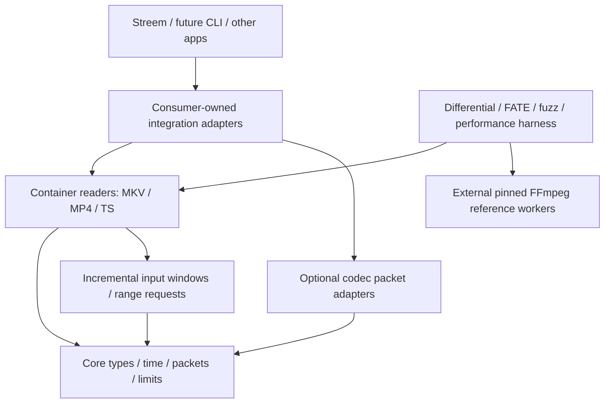

# ADR-0001: Independent core with evidence-gated dependencies

**Status:** Proposed architecture; owner constraints accepted as requirements.  
**Date:** 2026-10-30.  
**Decider:** Project owner, after reviewing scope and evidence.

## Context

The owner prefers clean bootstrapping in the age of AI and permits dependencies only when they fit perfectly, are pure safe Rust and are demonstrably better than implementing the bounded component. The initial customer needs compressed-packet playback on a constrained 32-bit target, not a desktop transcoder. FFmpeg sets the feature/performance reference. The owner now permits an initial-delivery runtime ratio up to1.25, retains0.80 as the optimization target, and keeps lower memory hard.

A new crate using `forbid(unsafe_code)` does not make its dependencies safe Rust. A safe public wrapper around C, assembly, custom unsafe arenas, or an unsafe transitive crate fails the stated production policy. The Rust standard library/compiler/OS substrate is the explicit trusted foundation; this is not a claim that the entire operating system or downstream TV application contains no unsafe code.

## Decision

Own the data model, input contract, resource accounting, error taxonomy, feature manifests and test framework. Bootstrap core and first container slice from specifications. Do not fork Symphonia, OxideAV, Rust-AV or Remade FFmpeg as the repository base. Keep their evaluation adapters outside the production graph. A future leaf dependency is admitted only through ADR-0002's gate.

The initial architecture is layered downward:

The diagram's FFmpeg worker belongs to tooling, not to a production dependency. No container crate knows LG, Jellyfin, a URL, authentication, UI state or a playback queue. No HTTP client, Tokio runtime, serialization framework or global registry is required by the core. Start with an internal module layout; split crates once a stable, independently useful boundary exists rather than creating dozens of empty crates.

## Proposed API semantics

These are design sketches, not a final Rust API or completed implementation:

- `SourceCapabilities`: optional length, sequential/random access, optional range support; absence of length is not EOF.
- `ReadStep`: event, need-more-bytes, need-a-byte-range, finished, unsupported, invalid-data, limit-exceeded or cancelled. The consumer performs blocking I/O outside the parser and feeds another bounded window. Parsers yield on a work budget, so cancellation does not depend on an OS read returning.
- `Track`: stable track ID; media/codec identity; exact codec configuration; language/name/dispositions; rational timebase; optional duration; codec delay/preroll; colour/HDR; attachments; typed and opaque extension metadata with source/provenance.
- `Packet`: track ID, immutable payload or bounded scatter/gather spans, optional **signed** PTS and DTS, optional duration, explicit random-access/discard/corruption facts, raw side data and trim values. Unknown and derived timing remain distinguishable. Do not discard negative timestamps or conflate decode and presentation order.
- `SeekRequest`: requested content time, target track, previous-random-access/exact policy and scan budget. `SeekReceipt` reports actual landing, preroll and whether an index or bounded scan was used. A returned timestamp alone is not proof the next packet can be decoded. Unsupported seek is explicit.
- `Budget`: checked integer arithmetic and fallible reservations before allocation; charge retained **capacity**, shared buffers once, metadata, indexes, decompressed bytes and output growth. Work, decompression ratio, nesting and scan distance are bounded separately. Live allocations carry their budget charge through cloning and across caller retention.

A parser never fabricates a valid-looking frame after incomplete data. A transport failure, temporary starvation, malformed stream and known-size end position are different outcomes. Progress and parser state are retained across incremental input; zero-byte input is not permission to loop forever. Nested structures have a depth limit or iterative traversal. Allocator exhaustion must surface as an explicit error wherever the allocator API permits recovery; do not promise recovery from every process-wide OOM.

## Options considered

| Option | Benefit | Cost / reason for disposition |
|---|---|---|
| Symphonia foundation | Coherent safe-Rust container framework; useful current video/subtitle APIs and several strong packet results | Experimental video APIs, transitive safety audit required, packet random-access exposure and observed timestamp/seek differences; would import architecture and MPL obligations before proving fit. Keep as oracle/candidate only. |
| Fork a broad new Rust FFmpeg replacement | Large claimed feature surface and rapid activity | Source-level contract/safety gaps already found. Cannot equate activity or README percentages with maturity, coverage or a 20% speed win. Do not base on it. |
| Compose existing narrow readers | Smaller pieces may be easier to verify | Different timestamps, seeking, metadata and limits still require adaptation; each leaf must beat bootstrapping and meet the entire graph policy. Consider later. |
| Own small core + incremental readers | Exact limits, semantics, API and dependency policy; no inherited crate graph | We own conformance, fuzzing, performance and maintenance. This is the chosen direction, with evidence gates rather than an assumed superiority claim. |

## Performance approach

Avoid full-file buffering, copy-on-every-packet, per-byte virtual calls, repeated parsing and eagerly materializing unused metadata. Decode no movie frame in demuxing benchmarks. Use buffer reuse, contiguous checked slices, cached indexes and optional caller-selectable metadata. These are hypotheses to measure; safe Rust and architectural simplicity do not guarantee a speedup over optimized FFmpeg, particularly for SIMD-heavy codecs.

The owner later authorized a 1.25 initial-delivery runtime ceiling while retaining
0.80 as the optimization target. Both classifications and the lower-memory
thresholds apply to identical accepted work, not a smaller feature set. A failed
target remains failed; the harness must not move the denominator, hide slow
cases or weaken correctness to pass it.

## Consequences and next work

H0, the comparison/performance harness, and an initial K0 reader are now implemented experimentally; [implementation status](implementation.md) records qualified snapshot evidence, current incomplete coverage and closed broader gates. A standalone library remains reusable beyond Streem, while the TV integration can retain FFmpeg during development. We must budget substantial work for unusual files and standards compliance. Every later codec gets an independent feature decision and benchmark. No third-party production dependency is selected by this ADR.

Proposed follow-ups: [ADR-0003](container-model.md) turns the API sketch above into one shared container model, and [ADR-0004](refactor-plan.md) lays out a behaviour-preserving refactor towards a layered, modular workspace.
